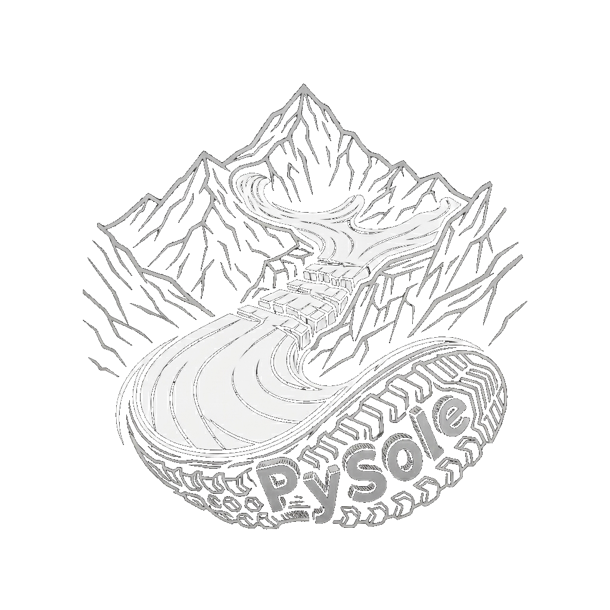

<p align="center">
  
</p>
<p style="text-align: center; font-size: 20px;"><strong>Physically-Informed Bedrock Interpolation & 3D Ray-Based Migration for Sparse Geophysical Datasets</strong></p>

`PySole` is designed to reconstruct the thickness distribution and basal topography (sole) of glaciers, landslides, and other gravity-driven, viscous flow phenomena. The highly simplified **Shallow Ice Approximation** describes gravity-driven, viscous flow by its fundamental inverse relation between depth of the creeping body and its surface slope, where greater depths correspond to gentler surface slopes and vice versa. `PySole` leverages real field data to adapt this basic viscous flow characteristic into simple, but powerful thickness predictors. It is specifically engineered for sparse geophysical datasets where 3D wavefield migration to image the bedrock is impossible due to insufficient spatial sampling. `PySole` transforms limited survey points into robust, physically-constrained 3D bedrock models.

---

## Table of Contents

[Key Features](#key-features)<br><br>
[Baseline Workflow & Methodology](#workflow-and-methodology)<br><br>
[Installation](#installation)<br><br>
[JSON Configuration File](#json-configuration)<br><br>
[JSON Configuration Parameter Reference](#json-configuration-parameter-reference)<br><br>
[Technical & Methodological Notes](#technical-and-methodological-notes)<br>
&nbsp;&nbsp;&nbsp;&nbsp;[1. Supported DEM Formats](#supported-dem-formats)<br>
&nbsp;&nbsp;&nbsp;&nbsp;[2. Parsing of Rock Outcrop Input Files](#parsing-rock-outcrops)<br>
&nbsp;&nbsp;&nbsp;&nbsp;[3. Wavenumbers and Wavelengths](#wavenumber-to-wavelength-conversion)<br>
&nbsp;&nbsp;&nbsp;&nbsp;[4. Variogram Binning with Minimum Pair Threshold](#variogram-binning)<br>
&nbsp;&nbsp;&nbsp;&nbsp;[5. High-Performance Dual Kriging Vector Engine](#dual-kriging-vector-engine)<br>
&nbsp;&nbsp;&nbsp;&nbsp;[6. Universal Kriging Drift Models](#universal-kriging-drift-models)<br>
&nbsp;&nbsp;&nbsp;&nbsp;[7. Kriging Uncertainty Derivation](#kriging-uncertainty-derivation)<br>
&nbsp;&nbsp;&nbsp;&nbsp;[8. Memory Guard and Kriging Uncertainty](#memory-guard-and-uncertainty)<br>
&nbsp;&nbsp;&nbsp;&nbsp;[9. Spatial Smoothing of the Calculated DEMs](#dem-spatial-smoothing)<br><br>
[Package Architecture](#package-architecture)<br><br>
[Command Line Interface](#cli)<br><br>
[Application Programming Interface](#api)<br><br>
[Real-World Example: Wurtenkees Glacier](#real-world-example-wurtenkees-glacier)<br><br>
[Citation & References](#citation-and-references)

---

<a id="key-features"></a>
## Key Features

* **JSON Configuration & Terminal CLI Driven:** All processing workflow options can be defined in a [`pysole.json`](#json-configuration) file and executed via Python Application Programming Interface ([API](#api)) or directly from the terminal using the `pysole` command line interface ([CLI](#cli)).
* **Multi-Core Parallel Acceleration:** `PySole` supports multi-core CPU parallelization across computationally intensive processing steps.
* **Automated High-Resolution Diagnostic Plots:** Automatically generates and exports diagnostic figures for each key processing milestone.
* **5 Supported Digital Elevation Model (DEM) Formats:** Seamless loading and exporting of GeoTIFFs (`.tif`), ESRI ASCII Grids (`.asc`, `.txt`), 3-column or 2D CSV grids (`.csv`), NumPy binary arrays (`.npy`), and in-memory 2D arrays (`np.ndarray`) — see [Supported DEM Formats](#supported-dem-formats).
* **Strict Coordinate Reference System & Spatial Alignment Verification:** Verifies CRS and spatial bounds across all input layers (DEM, boundary outline, survey points, and optional mass balance / velocity rasters), halting with an explicit error on misalignment.
* **Flexible Survey Data Types:** Accepts one- or two-way signal traveltimes as well as direct thickness/depth measurements (automatically skipping 3D migration when depth data are provided).
* 💡**DEM Surface Slope Smoothing💡:** The degree of DEM surface slope smoothing is crucial when estimating ice thickness with the <i>Shallow Ice Approximation</i> (SIA), which assumes a constant basal shear stress. By relaxing this rigid baseline constraint, Binder et al. ([2009](https://www.cambridge.org/core/journals/annals-of-glaciology/article/determination-of-total-ice-volume-and-icethickness-distribution-of-two-glaciers-in-the-hohe-tauern-region-eastern-alps-from-gpr-data/9CEE8439239FE7E9199513292C5D3D2F)) derived an objective, field-data-driven optimization criterion for the surface slope smoothing process, which is implemented in `PySole`. The optimal degree of surface slope smoothing is derived by enforcing minimum spatial variance in basal shear stress as the optimization criterion:
  <p align="center">
  $$\min_{k_{\text{c}}} \text{Var}_{xy}(\tau_{\text{b}})$$
  </p>

  In shallow ice dynamics, basal shear stress is given by:

  <p align="center">
  $$\tau_{\text{b}} = \rho_{\text{ice}} \, g \, D \sin(\alpha)$$
  </p>

  where ice density, <i>ρ</i><sub>ice</sub>, and gravitational acceleration, <i>g</i>, are assumed to be constant. Thus, only the product of ice depth and surface slope, <i>P</i> = <i>D</i> sin(<i>α</i>), is evaluated during the optimization process. The surface DEM is smoothed by Gaussian low-pass filtering in the 2D Fast Fourier Transform (FFT) frequency domain, defined by the spatial cutoff wavenumber <i>k</i><sub>c</sub> [rad/m] or cutoff wavelength <i>λ</i><sub>c</sub> [m] — see [Wavenumbers and Wavelengths](#wavenumber-to-wavelength-conversion). The spatial variance of <i>τ</i><sub>b</sub> is quantified via variogram analysis, with an optional interactive mode to refine spectral cutoffs and variogram parameters. The resulting optimal surface slope field directly informs pre- and post-migration interpolation, 3D ray-based migration, surface curvature estimation, and flow velocity filtering. Both the FFT low-pass filtering and product variogram evaluations are multi-threaded across CPU cores.
* **3D Ray-Based Migration:** Optional 3D ray-based migration introduced by Binder et al. ([2009](https://www.cambridge.org/core/journals/annals-of-glaciology/article/determination-of-total-ice-volume-and-icethickness-distribution-of-two-glaciers-in-the-hohe-tauern-region-eastern-alps-from-gpr-data/9CEE8439239FE7E9199513292C5D3D2F)) for sparse geophysical signal traveltimes, using the optimally smoothed surface slope field for numerically stable ray displacement vectors.
* **Kriging Interpolation:** Native, parallelized 2D Dual Kriging engine supporting Ordinary and Universal Kriging (plus Regression Kriging via `PyKrige`) — see [Dual Kriging Vector Engine](#dual-kriging-vector-engine) and [Baseline Workflow & Methodology](#workflow-and-methodology). Optional Kriging estimation uncertainty fields are evaluated alongside predicted grids when `calculate_uncertainty: true` — see [Kriging Uncertainty Derivation](#kriging-uncertainty-derivation).
* **Interactive Drift Analyzer:** Automated diagnostic engine that evaluates and ranks up to **120 candidate models** built from 8 physical and spatial drift primitives (`"sia"`, `"z_dem"`, `"curvature_dem"`, `"mass_balance"`, `"velocity"`, `"velocity_sia"`, `"linear_xy"`, `"quadratic_xy"`) plus Ordinary Kriging, with support for multi-model comparison suites, per-model diagnostic plots, and cross-model comparison tables — see [Drift Analyzer Guide](docs/drift_analyzer.md).
* **ML Hole Filling & Geomorphological Margin Blending:** Optional [`scikit-learn`](https://scikit-learn.org) Random Forest regression gap filling and geomorphological margin blending to smoothly taper bedrock elevations into surrounding surface DEM terrain.
* **Final DEMs Spatial Smoothing:** Optional post-processing spatial smoothing (`"gaussian"`, `"median"`, `"fft_lowpass"`) for the calculated thickness and bedrock DEMs — see [Spatial Smoothing of the Calculated DEMs](#dem-spatial-smoothing).
* **Survey Planner:** Automatically generates physically-informed longitudinal flowline and transverse cross-profile survey layouts for unprobed glaciers based on a synthetic SIA thickness model, exporting field-ready GPX and GeoJSON tracks — see [Survey Planner Guide](docs/survey_planner.md).

---

<a id="workflow-and-methodology"></a>
## Baseline Workflow & Methodology

<p align="center">
  <a href="images/pysole_processing_pipeline.png">
    
  </a>
  <br>
  <em>Figure 1:  End-to-end baseline workflow of the PySole solver dual-path processing pipeline. Click diagram to view in high resolution.</em>
</p>

#### 1. DEM Loading & Metadata
Grid spacing (`dx`, `dy`) and spatial bounds are automatically extracted from GeoTIFF and ESRI ASCII DEM metadata headers (and autodetected for 3-column `.csv` tables). If target `dx` and `dy` pixel resolutions are specified, 2D bilinear grid resampling is performed automatically. For headerless DEM formats (2D `.csv` matrices, `.npy`, or `np.ndarray`), spatial parameters (`origin`, `crs`, `dx`, `dy`) are provided under `spatial_parameters` — see [Supported DEM Formats](#supported-dem-formats).

> [!CAUTION]
> All input datasets (DEM, survey data, outline geometries, and optional mass balance / velocity rasters) **must share a projected, metric coordinate reference system** (`"crs"`, e.g. UTM). Geographic coordinates (latitude/longitude in degrees) will cause invalid distance, surface slope, and basal shear stress calculations.

<a id="interpolation-strategies"></a>
#### 2. Pre-Migration Traveltime Interpolation
Across spatial wavenumber cutoffs <i>k</i><sub>c</sub>, the point products of traveltime observations and corresponding low-pass filtered surface slopes, <i>P</i><sub>T,i</sub> = <i>T</i><sub>i</sub> sin(<i>α</i><sub>smoothed,i</sub>), are evaluated. Once the minimum-variance optimization criterion is satisfied, the optimally smoothed surface slope field, sin(<i>α</i><sub>opt</sub>(<i>x</i>,<i>y</i>)) (clamped at `slope_floor_deg`, default <i>5°</i>, to prevent division singularities), is deployed in the subsequent Kriging interpolation:
- **BSS-derived Product `"P"` (Default Baseline)**: Interpolates <i>P</i><sub>T,i</sub> using <b>Ordinary Kriging</b> (constant local mean without external drift) with optional zero-traveltime boundary conditions (<i>T</i> = 0 s), then reconstructs the continuous traveltime field <i>T</i>(<i>x</i>,<i>y</i>) via slope division:

  <p align="center">
  $$T(x,y) = \frac{P_{\text{T}}(x,y)}{\sin(\alpha_{\text{opt}}(x,y))}$$
  </p>

- **Direct `"T"` Baseline**: Directly interpolates signal traveltimes <i>T</i><sub>i</sub> using <b>Universal Kriging</b> with the physically-informed [`["sia"]`](#universal-kriging-drift-models) drift model by default (or any candidate selected via the [Drift Analyzer](docs/drift_analyzer.md)).

> [!CAUTION]
> Avoid interpolating a BSS-derived product target (`"P"`) with Universal Kriging using `["sia"]` or `["velocity_sia"]`! Dividing <i>P</i> by sin(<i>α</i><sub>opt</sub>) after fitting an inverse-slope drift introduces an unphysical 1/sin²(<i>α</i>) double-scaling artifact at low slopes. Use `"sia"` and `"velocity_sia"` only with direct targets (`"T"` or `"D"`).

#### 3. 3D Ray-Based Migration
Solves the Eikonal equation to relocate subsurface reflection points along 3D ray paths, improving the imaging of steep valley flanks and basal overdeepenings. An optional interactive mode allows testing different signal propagation velocities and inspecting horizontal survey point displacements.

#### 4. Post-Migration Surface Slope Optimization
Re-evaluates the spectral optimization criterion on the migrated depths, <i>P</i><sub>D,i</sub> = <i>D</i><sub>i</sub> sin(<i>α</i><sub>smoothed,i</sub>), across wavenumber cutoffs <i>k</i><sub>c</sub> to determine the post-migration optimal surface slope field sin(<i>α</i><sub>opt</sub>(<i>x</i>,<i>y</i>)).

#### 5. Final Depth Interpolation & Uncertainty Display
Reconstructs continuous ice thickness <i>D</i>(<i>x</i>,<i>y</i>) and bedrock elevation <i>Z</i><sub>bed</sub>(<i>x</i>,<i>y</i>) using either:
- **BSS-derived Product `"P"` (Default Baseline)**: Interpolates <i>P</i><sub>D,i</sub> = <i>D</i><sub>i</sub> sin(<i>α</i><sub>opt,i</sub>) via <b>Ordinary Kriging</b> (with optional <i>D</i> = 0 m boundary conditions) and divides by sin(<i>α</i><sub>opt</sub>(<i>x</i>,<i>y</i>)):

  <p align="center">
  $$D(x,y) = \frac{P_{\text{D}}(x,y)}{\sin(\alpha_{\text{opt}}(x,y))}$$
  </p>

- **Direct `"D"` Baseline**: Directly interpolates (migrated) depths <i>D</i><sub>i</sub> using <b>Universal Kriging</b> (defaulting to [`["sia"]`](#universal-kriging-drift-models), or evaluated across up to 120 drift models with the [Drift Analyzer](docs/drift_analyzer.md)).

When `calculate_uncertainty: true`, Kriging estimation variance is converted to standard error (<i>σ</i><sub>D</sub> = √<i>σ</i>²) to map spatial thickness uncertainty and total volume uncertainty — see [Kriging Uncertainty Derivation](#kriging-uncertainty-derivation).

---

<a id="installation"></a>
## Installation

### Direct Installation from GitHub (<i>Recommended</i>)

You can install `PySole` directly from GitHub using `pip`:

```bash
pip install git+https://github.com/da0bi/pysole.git
```

### PyPI Installation

🚨 *NOT AVAILABLE YET* 🚨

```bash
pip install pysole
```

### Local / Development Installation

To clone and install `PySole` directly from source in editable mode:

```bash
git clone https://github.com/da0bi/pysole.git
cd pysole
pip install -e .
```

---

<a id="json-configuration"></a>
## JSON Configuration File

All execution options can be fully defined in a single JSON configuration file, which by default is named `pysole.json`. Whenever an optional parameter key or entire section is omitted from the JSON file, `PySole` automatically populates it with its default value and continues without error. This is, however, not true for the `survey_data_path` key - if this is left empty, or totally omitted, the `Survey Planner` is automatically started - see [here](docs/survey_planner.md) for details. Unknown keys in the configuration file never stop a `PySole` run - they are reported in a single warning and ignored.

```json
{
    "inputs": {
        "dem_path": null,
        "outline_path": null,
        "survey_data_path": null,
        "survey_data_type": "one_way_traveltime",
        "survey_profile_column": null,
        "mass_balance_path": null,
        "velocity_path": null,
        "ice_density": 900.0,
        "g": 9.81,
        "n_cores": -1,
        "log_level": "INFO",
        "show_progress": true
    },
    "spatial_parameters": {
        "dx": null,
        "dy": null,
        "bounds": null,
        "origin": null,
        "crs": null
    },
    "migration_parameters": {
        "perform_migration": true,
        "velocity": 0.16,
        "interactive_migration": false,
        "horizontal_displacement_visualization": "arrows"
    },
    "optimization_parameters": {
        "fft_filter_metric": "wavenumber",
        "kc_max": null,
        "kc_min": null,
        "lambda_min": null,
        "lambda_max": null,
        "n_steps": null,
        "nrbins": null,
        "slope_floor_deg": 5.0,
        "interactive_optimization": false
    },
    "kriging_parameters": {
        "engine": "native",
        "max_memory_fraction": 0.5,
        "pre_migration": {
            "interpolation_target": "P",
            "method": "ordinary",
            "drift_analyzer": false,
            "drift_terms": null,
            "variogram_model": "spherical",
            "include_zero_boundary_condition": true,
            "calculate_uncertainty": false
        },
        "post_migration": {
            "interpolation_target": "P",
            "method": "ordinary",
            "drift_analyzer": false,
            "drift_terms": null,
            "variogram_model": "spherical",
            "include_zero_boundary_condition": true,
            "calculate_uncertainty": false
        }
    },
    "finalization_parameters": {
        "interactive_finalization": false,
        "random_forest_gap_filling": false,
        "apply_margin_blend": false,
        "min_gap_dist": 50.0,
        "smooth_bedrock": false,
        "smoothing_method": "gaussian",
        "smoothing_sigma": 1.5,
        "smoothing_kernel_size": 3,
        "smoothing_kc_cutoff": null
    },
    "outputs": {
        "output_dir": null,
        "output_format": "tif",
        "output_prefix": "",
        "plots_dir": "figures",
        "save_bedrock_grid": true,
        "save_traveltime_grid": false,
        "save_traveltime_uncertainty": false,
        "save_migrated_points": false,
        "save_thickness_grid": false,
        "save_thickness_uncertainty": false,
        "save_basal_shear_stress": false,
        "save_basal_shear_stress_uncertainty": false
    }
}
```

---

<a id="json-configuration-parameter-reference"></a>
## JSON Configuration Parameter Reference

| Section | Parameter | Type | Default | Description |
| :--- | :--- | :--- | :--- | :--- |
| **`inputs`** | `dem_path` | `str` | `null` | **(Required)** File path to the surface Digital Elevation Model (`.asc`, `.tif`, `.csv`, `.npy`). |
| | `outline_path` | `str` | `null` | File path to creeping body / glacier boundary polygon (`.shp`, `.geojson`, `.gpkg`, `.csv`). If `null`, domain is derived from non-NaN DEM pixels. |
| | `survey_data_path` | `str` | `null` | File path to signal traveltime or thickness observations CSV `[(profile_id), X, Y, value]`. If `null`, `PySole` automatically starts the interactive `Survey Planner` and saves the results to the file paths defined in the `outputs` section.  See [`here`](docs/survey_planner.md) for full details. |
| | `survey_data_type` | `str` | `"one_way_traveltime"` | Observation data type: `"one_way_traveltime"`, `"two_way_traveltime"`, or `"depth"` (skips 3D migration). |
| | `survey_profile_column` | `str` | `null` | Optional column name in the imported survey dataset CSV (`inputs.survey_data_path`) specifying survey line / profile IDs for the Drift Analyzer's <i>Leave-One-Profile-Out</i> (LOPO) cross-validation. |
| | `mass_balance_path` | `str` | `null` | Optional file path to a decadal-mean surface mass balance raster (`.tif`, `.asc`, `.csv`, `.npy`). Automatically co-registered to the DEM grid (kept unsmoothed to preserve local debris/avalanche features). Enables the `"mass_balance"` drift term and serves as an additional feature in Random Forest gap filling. |
| | `velocity_path` | `str` | `null` | Optional file path to a decadal-mean surface flow velocity magnitude raster (`.tif`, `.asc`, `.csv`, `.npy`). Automatically co-registered to the DEM grid, zero-clamped outside the glacier outline, and spectrally low-pass filtered at optimal <i>k</i><sub>c</sub>. Enables the `"velocity"` and `"velocity_sia"` drift terms and serves as an additional feature in Random Forest gap filling. |
| | `ice_density` | `float` | `900.0` | Density of the creeping medium in kg/m³ (`900.0` kg/m³ for temperate glacier ice by default). Used to calculate basal shear stress <i>τ</i><sub>b</sub>. |
| | `g` | `float` | `9.81` | Gravitational acceleration constant in m/s² (`9.81` m/s²). Used to calculate basal shear stress <i>τ</i><sub>b</sub>. |
| | `n_cores` | `int` | `-1` | Number of CPU cores applied across all parallelized processes (`-1` for all available cores). |
| | `log_level` | `str` | `"INFO"` | Package logging level verbosity: `"INFO"` (default), `"DEBUG"`, `"WARNING"`, `"ERROR"`, or `"CRITICAL"`. Appends timestamped logs to `pysole.log`. |
| | `show_progress` | `bool` | `true` | If `true` (default), displays terminal progress bars during heavy processing steps. Set automatically to `false` if running `PySole` in batch processing scripts. |
| **`spatial_parameters`** | `dx` | `float` | `null` | Target grid resolution along X in meters. If defined, automatically resamples the DEM grid. If `null`, native resolution is kept. |
| | `dy` | `float` | `null` | Target grid resolution along Y in meters. If defined, automatically resamples the DEM grid. If `null`, native resolution is kept. |
| | `bounds` | `list[float]` | `null` | Optional spatial bounding box `[minx, miny, maxx, maxy]`. Leave `null` by default. Use only to manually override invalid or missing spatial bounds in DEM raster headers (`.asc`, `.tif`). `bounds` are automatically calculated from `origin`, `dx`, `dy`, and grid dimensions for headerless DEMs (`.csv`, `.npy`). |
| | `origin` | `list[float]` | `null` | Lower-left coordinate origin `[xll, yll]` in projected metric units for headerless DEM formats (`.csv`, `.npy`, `np.ndarray`). If `null`, defaults to `(0.0, 0.0)`. |
| | `crs` | `str` / `int` | `null` | Coordinate Reference System (optional, e.g. `"EPSG:32633"`, `32633`, or PROJ string). When provided, validates metric projection, checks spatial alignment with vector outlines, and embeds EPSG metadata into output GeoTIFFs. |
| **`migration_parameters`** | `perform_migration` | `bool` | `true` | If `true`, performs 3D ray-based migration on signal traveltimes. If `false`, migration is skipped. |
| | `velocity` | `float` | `0.16` | Signal propagation velocity (default value of `0.16` m/ns is characteristic for radar wave propagation in temperate ice). |
| | `interactive_migration` | `bool` | `false` | If `true`, enables interactive velocity testing with visual migrated depths and horizontal displacement vector plots. |
| | `horizontal_displacement_visualization` | `str` | `"arrows"` | Horizontal displacement visualization mode: `"arrows"` (default, quiver displacement vectors overlaid on traveltime grid) or `"grad_traveltime_grid"` (displays traveltime field without arrows, and creates a companion figure `##_<output_prefix>_3d_migration_hor_displacements.png` showing traveltime gradient grid and original and migrated survey points). |
| **`optimization_parameters`** | `fft_filter_metric` | `str` | `"wavenumber"` | Frequency spectrum filter metric: `"wavenumber"` [rad/m] or `"wavelength"` [m]. |
| | `kc_max` | `float` | `null` | Maximum corner frequency cutoff <i>k</i><sub>c,max</sub> in [rad/m]. If `null`, defaults to grid Nyquist wavenumber <i>k</i><sub>Nyquist</sub>. For full details, see [here](#wavenumber-to-wavelength-conversion). |
| | `kc_min` | `float` | `null` | Minimum corner frequency cutoff <i>k</i><sub>c,min</sub> in [rad/m]. If `null`, defaults to half of the DEM extent. For full details, see [here](#wavenumber-to-wavelength-conversion).|
| | `lambda_min` | `float` | `null` | Minimum spatial cutoff wavelength <i>λ</i><sub>min</sub> in [m]. If `null`, falls back directly to `kc_max`. For full details, see [here](#wavenumber-to-wavelength-conversion). |
| | `lambda_max` | `float` | `null` | Maximum spatial cutoff wavelength <i>λ</i><sub>max</sub> in [m]. If `null`, falls back directly to `kc_min`. For full details, see [here](#wavenumber-to-wavelength-conversion). |
| | `n_steps` | `int` | `null` | Number of evaluation steps across <i>k</i><sub>c</sub> spectrum using logarithmic/geometric spacing (`np.geomspace`). If `null`, dynamically calculated from DEM grid dimensions and constrained by [10, 50]. For full details, see [here](#wavenumber-to-wavelength-conversion). |
| | `nrbins` | `int` | `null` | Number of variogram lag distance bins. If `null` (default), dynamically calculated to receive ~30 point pairs per bin. The number of bins is constrained by a maximum of 30 and an absolute minimum of 3 bins. For full details, see [here](#variogram-binning). |
| | `slope_floor_deg` | `float` | `5.0` | Minimum surface slope angle threshold in degrees [°] enforced during surface slope optimization to prevent numerical division singularities. |
| | `interactive_optimization` | `bool` | `false` | If `true`, enables interactive CLI prompt to inspect BSS variance curve and adjust corner frequency spectrum parameters (`kc_min`, `kc_max`, `lambda_min`, `lambda_max`, `n_steps`), lag distance bin count (`nrbins`), and correlation range (`a_range`). |
| **`kriging_parameters`** | `engine` | `str` | `"native"` | Kriging calculation engine: `"native"` (default, high-performance Dual Kriging solver) or `"pykrige"` (uses external [`PyKrige`](https://geostat-framework.readthedocs.io/projects/pykrige) package - optional dependency in `pyproject.toml`). Both engines support `"ordinary"` and `"universal"` with every drift term, however, it is recommended to use the numerically optimized `"native"` engine. `"regression"` is only available through `PyKrige` (if `engine` is `"native"` automatically switches to `"pykrige"` and posts a log message). See the [engine support matrix](#how-drift-terms-is-interpreted) below. |
| | `max_memory_fraction` | `float` | `0.5` | Fraction of the available RAM (`0 < f ≤ 0.9`) that the native Kriging solver may use. If the estimate exceeds it, the worker threads are reduced first; the Kriging variance is skipped only as a last resort. Also available as `Solver(max_memory_fraction=...)`. See [here](#memory-guard-and-uncertainty) for details. |
| | `pre_migration` | `dict` | *Sub-section* | Configuration for pre-migration traveltime field, <i>T</i>(<i>x</i>,<i>y</i>), interpolation. |
| | `pre_migration.interpolation_target` | `str` | `"P"` | Pre-migration interpolation target: `"P"` for BSS-derived products (<i>P</i> = <i>T</i><sub>i</sub> · sin <i>α</i><sub>opt, i</sub>, default) or `"T"` for direct signal traveltimes (<i>T</i><sub>i</sub>). |
| | `pre_migration.method` | `str` | *by target* | Kriging approach: `"ordinary"` (constant mean, default for `"P"`), `"universal"` (external drift, default for `"T"`), or `"regression"` (only available through `PyKrige`). `"ordinary"` overrides `pre_migration.drift_analyzer` and `pre_migration.drift_terms` (both are ignored with a warning). See [How `drift_terms` is interpreted](#how-drift-terms-is-interpreted). |
| | `pre_migration.drift_analyzer` | `bool` | `false` | If `true`, the [Drift Analyzer](docs/drift_analyzer.md) cross-validates candidate drift models for `method: "universal"` and prompts for selection (batch mode selects the top-ranked model). When `drift_terms` is `null`, evaluates the dynamic default suite (24, 48, 60, or 120 candidates depending on `mass_balance_path` and `velocity_path`). Ignored for `"ordinary"`, skipped with a warning for `"regression"`, and auto-disabled if `drift_terms` defines a single candidate. |
| | `pre_migration.drift_terms` | `list` / `null` | `null` | `null` or a flat/nested list of primitives (`"sia"`, `"z_dem"`, `"curvature_dem"`, `"mass_balance"`, `"velocity"`, `"velocity_sia"`, `"linear_xy"`, `"quadratic_xy"`). See [Universal Kriging Drift Models](#universal-kriging-drift-models) and [How `drift_terms` is interpreted](#how-drift-terms-is-interpreted). |
| | `pre_migration.variogram_model` | `str` | `"spherical"` | Theoretical variogram model (`"spherical"`, `"exponential"`, `"gaussian"`, `"linear"`). `"linear"` is only supported under `engine: "pykrige"` (falls back to `"spherical"` under `"native"`). |
| | `pre_migration.include_zero_boundary_condition` | `bool` | `true` | If `true` (default), includes zero traveltime boundary points (<i>T</i> = 0 s) along the perimeter and rock outcrop margin outline(s). |
| | `pre_migration.calculate_uncertainty` | `bool` | `false` | If `true`, computes the Kriging estimation variance during pre-migration Kriging. Defaults to `false` to save computational time. |
| | `post_migration` | `dict` | *Sub-section* | Configuration for final bedrock depth, <i>D</i>(<i>x</i>,<i>y</i>), interpolation. |
| | `post_migration.interpolation_target` | `str` | `"P"` | Post-migration interpolation target: `"P"` for BSS-derived products (<i>P</i> = <i>D</i><sub>i</sub> · sin <i>α</i><sub>opt, i</sub>, default) or `"D"` for direct (migrated) depths (<i>D</i><sub>i</sub>). |
| | `post_migration.method` | `str` | *by target* | Kriging approach: `"ordinary"` (constant mean, default for `"P"`), `"universal"` (external drift, default for `"D"`), or `"regression"` (only available through `PyKrige`). `"ordinary"` overrides `post_migration.drift_analyzer` and `post_migration.drift_terms` (both are ignored with a warning). See [How `drift_terms` is interpreted](#how-drift-terms-is-interpreted). |
| | `post_migration.drift_analyzer` | `bool` | `false` | If `true`, the [Drift Analyzer](docs/drift_analyzer.md) cross-validates candidate drift models for `method: "universal"` and prompts for selection (batch mode selects the top-ranked model). When `drift_terms` is `null`, evaluates the dynamic default suite (24, 48, 60, or 120 candidates depending on `mass_balance_path` and `velocity_path`). Ignored for `"ordinary"`, skipped with a warning for `"regression"`, and auto-disabled if `drift_terms` defines a single candidate. |
| | `post_migration.drift_terms` | `list` / `null` | `null` | `null` or a flat/nested list of primitives (`"sia"`, `"z_dem"`, `"curvature_dem"`, `"mass_balance"`, `"velocity"`, `"velocity_sia"`, `"linear_xy"`, `"quadratic_xy"`). See [Universal Kriging Drift Models](#universal-kriging-drift-models) and [How `drift_terms` is interpreted](#how-drift-terms-is-interpreted). |
| | `post_migration.variogram_model` | `str` | `"spherical"` | Theoretical variogram model (`"spherical"`, `"exponential"`, `"gaussian"`, `"linear"`). `"linear"` is only supported under `engine: "pykrige"` (falls back to `"spherical"` under `"native"`). |
| | `post_migration.include_zero_boundary_condition` | `bool` | `true` | If `true` (default), includes zero thickness boundary points (<i>D</i> = 0 m) along the perimeter and rock outcrop margin outline(s). |
| | `post_migration.calculate_uncertainty` | `bool` | `false` | If `true`, computes the Kriging estimation variance during post-migration Kriging. Defaults to `false` to save computational time. |
| **`finalization_parameters`** | `interactive_finalization` | `bool` | `false` | If `true`, enables interactive terminal prompts to inspect and adjust finalization parameters (smoothing, RF gap filling, margin blending) with real-time figure 07 refresh before finalizing. |
| | `random_forest_gap_filling` | `bool` | `false` | If `true`, applies Random Forest machine learning gap filling across unmeasured interior regions. |
| | `apply_margin_blend` | `bool` | `false` | If `true`, applies geomorphological margin blending to seamlessly transition calculated bedrock elevation to surrounding surface DEM terrain. |
| | `min_gap_dist` | `float` | `50.0` | Minimum gap distance in meters inside which bedrock is smoothly tapered and blended into surface DEM terrain. |
| | `smooth_bedrock` | `bool` | `false` | If `true`, applies spatial DEM post-processing smoothing directly to the depth field <i>D</i>(<i>x</i>,<i>y</i>) to eliminate high-frequency slope-division noise. |
| | `smoothing_method` | `str` | `"gaussian"` | Final bedrock DEM smoothing algorithm choice: `"gaussian"` (default), `"median"`, or `"fft_lowpass"`. |
| | `smoothing_sigma` | `float` | `1.5` | Smoothing strength (radius in pixels) for `"gaussian"` filtering. Higher values produce smoother bedrock terrain. |
| | `smoothing_kernel_size` | `int` | `3` | Window kernel size (<i>k</i> × <i>k</i>) for `"median"` filtering (must be an odd integer). Higher values produce smoother bedrock terrain. |
| | `smoothing_kc_cutoff` | `float` | `null` | Corner frequency cutoff wavenumber (<i>k</i><sub>c,smooth</sub>) for `"fft_lowpass"`. If `null`, defaults to <i>k</i><sub>c,opt</sub> from the surface slope smoothing optimization. <i>Lower</i> values produce smoother bedrock terrain. |
| **`outputs`** | `output_dir` | `str` | `null` | General workspace directory for all output files. `"."` defines `output_dir` as the parent directory of the `pysole.json` configuration file. If `null` (default), automatically creates a `pysole` folder inside the parent directory of `survey_data_path`. All relative output paths are resolved relative to `output_dir`. Absolute output paths override `output_dir`. |
| | `output_format` | `str` / `list[str]` | `"tif"` | Desired export format(s): `"tif"`, `"asc"`, `"csv"`, `"npy"`, a list of formats (e.g. `["tif", "asc", "csv"]`), or `"all"` to export all four formats. |
| | `output_prefix` | `str` | `""` | Optional filename prefix or absolute filepath prefix prepended to export filenames. When empty (default `""`), exports use clean standard names with applied drift model slug (e.g. `bedrock_<model_slug>.<ext>`, `thickness_<model_slug>.<ext>`) and diagnostic figures follow `##_<name>.png`. When specified, exports become `<output_prefix>_<name>_<model_slug>.<ext>` and figures follow `##_<output_prefix>_<name>.png` (migrated points CSV is exported as `[<output_prefix>_]migrated_points.csv` without drift slug). Absolute filepath prefix overrides `output_dir` and diagnostic figures are written beside it in a `figures/` subfolder. |
| | `plots_dir` | `str` | `"figures"` | Diagnostic figures are always saved - `plots_dir` controls *where*. `null` is equivalent to `"figures"`. A relative path is resolved inside `output_dir`, or absolute `output_prefix`. `PySole` data products and figures always share the same location, except an absolute `plots_dir` is defined. |
| | `save_bedrock_grid` | `bool` | `true` | If `true` (default), exports the predicted bedrock elevation raster grid <i>Z</i><sub>bed</sub>(<i>x</i>,<i>y</i>) to `<output_prefix>_bedrock_<model_slug>.<ext>`. |
| | `save_traveltime_grid` | `bool` | `false` | If `true`, exports the pre-migration interpolated traveltime raster grid, <i>T</i>(<i>x</i>,<i>y</i>), masked by the creeping body outline to `<output_prefix>_traveltime_<model_slug>.<ext>`. |
| | `save_traveltime_uncertainty` | `bool` | `false` | If `true`, exports the Kriging traveltime uncertainty raster grid, <i>σ<sub>T</sub></i>(<i>x</i>,<i>y</i>), in traveltime units and masked by the creeping body outline to `<output_prefix>_traveltime_uncertainty_<model_slug>.<ext>`. Requires `pre_migration.calculate_uncertainty: true`. Unavailable (with a warning) if migration is skipped or the survey data are depths. |
| | `save_migrated_points` | `bool` | `false` | If `true`, exports the 3D ray-migrated survey points to `<output_prefix>_migrated_points.csv` (`x, y, z_surface, depth_migrated`). If migration is skipped, it is automatically set to `false` and a log message is printed. |
| | `save_thickness_grid` | `bool` | `false` | If `true`, exports the final thickness raster grid, <i>D</i>(<i>x</i>,<i>y</i>), masked by the creeping body outline to `<output_prefix>_thickness_<model_slug>.<ext>`. |
| | `save_thickness_uncertainty` | `bool` | `false` | If `true`, exports the Kriging thickness uncertainty raster grid, <i>σ<sub>D</sub></i>(<i>x</i>,<i>y</i>), masked by the creeping body outline to `<output_prefix>_thickness_uncertainty_<model_slug>.<ext>`. Requires `post_migration.calculate_uncertainty: true`. Skipped with a warning if `calculate_uncertainty` is `false` or if the [memory guard](#memory-guard-and-uncertainty) had to skip the variance. |
| | `save_basal_shear_stress` | `bool` | `false` | If `true`, exports the final basal shear stress raster grid, <i>τ</i><sub>b</sub>(<i>x</i>,<i>y</i>), masked by the creeping body outline to `<output_prefix>_basal_shear_stress_<model_slug>.<ext>`. |
| | `save_basal_shear_stress_uncertainty` | `bool` | `false` | If `true`, exports the basal shear stress Kriging uncertainty raster grid, <i>σ</i><sub><i>τ</i><sub>b</sub></sub>(<i>x</i>,<i>y</i>), masked by the creeping body outline to `<output_prefix>_basal_shear_stress_uncertainty_<model_slug>.<ext>`. Requires `post_migration.calculate_uncertainty: true`. Skipped with a warning if `calculate_uncertainty` is `false` or if the [memory guard](#memory-guard-and-uncertainty) had to skip the variance. |

---

<a id="technical-and-methodological-notes"></a>
## Technical & Methodological Notes

<a id="supported-dem-formats"></a>
#### 1. Supported DEM Formats
`PySole` supports 5 distinct DEM formats:

- **GeoTIFF (`.tif`, `.tiff`, `.geotiff`)**: *Recommended*. Automatically extracts spatial bounds, CRS, pixel resolution, and `nodata` values using [`rasterio`](https://rasterio.readthedocs.io).
- **ESRI ASCII Grid (`.asc`, `.txt`)**: Standard 6-line header GIS raster format (`ncols`, `nrows`, `xllcorner`, `yllcorner`, `cellsize`, `nodata_value`). Explicitly defining `spatial_parameters.crs` is recommended.
- **CSV Grid (`.csv`)**: Supports both **2D elevation matrices** ([Z<sub>nx</sub> × Z<sub>ny</sub>], metadata from `spatial_parameters`) and **3-column XYZ grid tables** ([X, Y, Z], spacing and bounds inferred automatically).
- **NumPy Binary Array (`.npy`)**: Fast 2D binary array format; spatial metadata (`origin`, `crs`, `dx`, `dy`) defined via `spatial_parameters`.
- **NumPy 2D Array (`np.ndarray`)**: In-memory array passed directly into the `Solver` constructor (`dem=dem_grid`); spatial metadata defined via `spatial_parameters`.

<a id="parsing-rock-outcrops"></a>
#### 2. Parsing of Rock Outcrop Input Files
Vector polygon files (`.shp`, `.geojson`, `.gpkg`) or CSV outline files containing interior rings (separated by `NaN` rows) are automatically parsed as polygon holes. `PySole` treats pixels inside rock outcrop holes as exposed bedrock (<i>Z</i> = <i>Z</i><sub>Surface</sub>). When boundary conditions are enabled, the perimeters of interior rings are included with <i>T</i> = 0 s or <i>D</i> = 0 m.

For rock outcrop holes to be detected from a Shapefile (`.shp`):
- **Topology**: Stored as interior rings (`polygon.interiors`) within a `Polygon` / `MultiPolygon` feature (e.g. QGIS "Add Ring" or ArcGIS "Construct Hole").
- **Winding Order & Validity**: Standard OGC orientation (Clockwise exterior, Counter-Clockwise interior rings) without self-intersections (`validate_and_extract_polygons()` auto-repairs minor topology issues on load).
- **CRS Alignment**: Must match the DEM raster projection.

<a id="wavenumber-to-wavelength-conversion"></a>
#### 3. Wavenumbers and Wavelengths
In `PySole`, 2D spatial Gaussian low-pass smoothing operates in the physical 2D spatial frequency domain with wavenumber components <i>k</i><sub>x</sub>, <i>k</i><sub>y</sub> [rad/m] and magnitude <i>k</i> = √(<i>k</i><sub>x</sub>² + <i>k</i><sub>y</sub>²):

<p align="center">
$$k_x = \frac{2\pi \cdot \text{fftfreq}(N_x)}{dx}, \quad k_y = \frac{2\pi \cdot \text{fftfreq}(M_y)}{dy}, \quad k_c = \frac{2\pi}{\lambda_c} \Longleftrightarrow \lambda_c = \frac{2\pi}{k_c}$$
</p>

where <i>dx</i>, <i>dy</i> [m] are grid cell resolutions and <i>N</i><sub>x</sub>, <i>M</i><sub>y</sub> are grid dimensions. For a DEM with <i>dx</i> = <i>dy</i> = 5.0 m, the Nyquist wavelength is <i>λ</i><sub>Nyquist</sub> = 2 · min(|<i>dx</i>|, |<i>dy</i>|) = <b>10.0 m</b> (<i>k</i><sub>Nyquist</sub> = <i>π</i> / 5.0 ≈ <b>0.6283 rad/m</b>):

| Cutoff Wavenumber <i>k</i><sub>c</sub> [rad/m] | Spatial Wavelength <i>λ</i><sub>c</sub> [m] | Surface Feature Scale |
| :--- | :--- | :--- |
| **<i>k</i><sub>Nyquist</sub> ≈ 0.6283 rad/m** | **10.0 m** | Nyquist limit (2 · min(|<i>dx</i>|, |<i>dy</i>|), finest resolvable feature) |
| **0.3142 rad/m** | **20.0 m** | Fine spatial smoothing (filters features &lt; 20 m) |
| **0.1257 rad/m** | **50.0 m** | Medium-fine spatial smoothing |
| **0.0628 rad/m** | **100.0 m** | Medium spatial smoothing |
| **0.0314 rad/m** | **200.0 m** | Broad spatial smoothing |
| **0.0100 rad/m** | **628.3 m** | Very broad regional smoothing |

*Table 1: Physical Reference Conversion Table.*

##### Derivation of FFT Filter Parameter Defaults
When `kc_max`, `kc_min`, `lambda_min`, `lambda_max`, or `n_steps` are left as `null` in `pysole.json`, `PySole` derives defaults from the grid resolution and maximum domain extent <i>L</i><sub>max</sub> = max(<i>N</i><sub>x</sub> · |<i>dx</i>|, <i>M</i><sub>y</sub> · |<i>dy</i>|):
- **Maximum Wavenumber `kc_max` / Minimum Wavelength `lambda_min`**: Defaults to the Nyquist limit <i>k</i><sub>c,max</sub> = <i>k</i><sub>Nyquist</sub> = <i>π</i> / min(|<i>dx</i>|, |<i>dy</i>|) (<i>λ</i><sub>min</sub> = 2 · min(|<i>dx</i>|, |<i>dy</i>|)). Custom `lambda_min` converts via <i>k</i><sub>c,max</sub> = 2<i>π</i> / <i>λ</i><sub>min</sub>.
- **Minimum Wavenumber `kc_min` / Maximum Wavelength `lambda_max`**: Defaults to the half-domain limit <i>k</i><sub>c,min</sub> = 4<i>π</i> / <i>L</i><sub>max</sub> (<i>λ</i><sub>max</sub> = <i>L</i><sub>max</sub> / 2). Custom `lambda_max` converts via <i>k</i><sub>c,min</sub> = 2<i>π</i> / <i>λ</i><sub>max</sub>.
- **Evaluation Step Count `n_steps`**: Counts the integer Fourier modes across [<i>k</i><sub>c,min</sub>, <i>k</i><sub>c,max</sub>] clamped to [10, 50] and spaced geometrically (`np.geomspace`):
  <p align="center">
  $$n_{\text{steps}} = \min\left(50,\ \max\left(10,\ \left\lfloor \frac{(k_{\text{c,max}} - k_{\text{c,min}}) \cdot L_{\text{max}}}{2\pi} \right\rfloor\right)\right)$$
  </p>

After each surface slope optimization pass, both <i>k</i><sub>c,opt</sub> [rad/m] and <i>λ</i><sub>c,opt</sub> [m] are logged to the console and `pysole.log`.

<a id="variogram-binning"></a>
#### 4. Variogram Binning with Minimum Pair Threshold
Experimental variogram lag distance bins are calculated from pairwise Euclidean distances across <i>N</i> survey points. When `nrbins` is `null` (default), `PySole` sets the bin count from the number of point pairs within the variogram range <i>h</i> ≤ <i>h</i><sub>max</sub> (half of the maximum pairwise distance) to ensure at least **30 point pairs per bin** (Webster & Oliver, 2007), bounded to [3, 30]:

$$
\text{nrbins} = \min\left(30,\ \max\left(3,\ \left\lfloor \frac{N_{\text{pairs}}(h \le h_{\text{max}})}{30} \right\rfloor\right)\right)
$$

If a user-specified `nrbins` yields fewer than 30 average pairs per bin, a warning is logged while honoring the explicit choice (enforcing a floor of 3 bins). For large surveys (<i>N</i> &gt; 5000), lag statistics are accumulated in chunks using <i>N</i><sub>pairs</sub> = <i>N</i>(<i>N</i> − 1)/2.

<a id="dual-kriging-vector-engine"></a>
#### 5. High-Performance Dual Kriging Vector Engine
`PySole` features a native geostatistical engine based on **Dual Kriging** (Matheron, 1981). Unlike Primal Kriging (which solves a separate linear system at every target grid node), Dual Kriging solves the global (<i>N</i> + <i>L</i>) × (<i>N</i> + <i>L</i>) linear system **once** via LU decomposition (`scipy.linalg.lu_factor`):

<p align="center">
$$\mathbf{K} \mathbf{w}_z = \mathbf{z}_{\text{aug}}, \qquad Z_{\text{grid}}(x,y) = \mathbf{w}_z \cdot \mathbf{k}_{\text{grid}} = \mathbf{w}_{\text{sample}} \cdot \boldsymbol{\Gamma}_{\text{grid}} + \mathbf{w}_{\text{drift}} \cdot \mathbf{F}_{\text{grid}}$$
</p>

where <b>K</b> is the augmented sample variogram and drift matrix, <b>w</b><sub>z</sub> = [<b>w</b><sub>sample</sub><sup>T</sup>, <b>w</b><sub>drift</sub><sup>T</sup>]<sup>T</sup> is the solved global dual weight vector, and <b>k</b><sub>grid</sub> = [<b>Γ</b><sub>grid</sub><sup>T</sup>, <b>F</b><sub>grid</sub><sup>T</sup>]<sup>T</sup> combines the 1D sample-to-grid cross-variogram vector <b>Γ</b><sub>grid</sub> and the drift basis vector <b>F</b><sub>grid</sub> evaluated at (<i>x</i>,<i>y</i>). Point prediction across <i>m</i> grid nodes reduces to an <i>O</i>(<i>N</i> · <i>m</i>) BLAS dot product (~180x speedup over loop-based solvers, interpolating 300,000+ nodes in under 50 ms). The production solver and the `Drift Analyzer` share the same unified `KrigingSystem`.

##### Thread-Safe Level-3 BLAS Variance Engine
While point prediction requires only an <i>O</i>(<i>N</i> · <i>m</i>) vector dot product, evaluating Kriging estimation variance <i>σ</i>²(<i>x</i>,<i>y</i>) = <i>C</i>(0) − <b>k</b><sub>grid</sub><sup>T</sup> <b>K</b><sup>−1</sup> <b>k</b><sub>grid</sub> scales as <i>O</i>(<i>N</i>² · <i>m</i>) (disabled by default via `calculate_uncertainty: false`). When enabled, `PySole` pre-computes the explicit inverse <b>K</b><sup>−1</sup> once via `lu_solve(lu_piv, np.eye(N_aug))` prior to grid chunking, and worker threads (`ThreadPoolExecutor`) evaluate chunk variance weights via lock-free Level-3 BLAS matrix products (<b>W</b><sub>sub</sub> = <b>K</b><sup>−1</sup> <b>K</b><sub>rhs,sub</sub>) while `threadpoolctl` prevents BLAS thread oversubscription.

##### Adaptive Diagonal Tikhonov Regularization & Scale Invariance
To prevent ill-conditioning when soundings are densely spaced along GPR profiles, `PySole` applies adaptive diagonal Tikhonov regularization strictly to the <i>N</i> × <i>N</i> sample observation block <b>K</b><sub>ii</sub> += <i>λ</i><sub>reg</sub> (<i>i</i> = 1, …, <i>N</i>), scaled by the empirical variogram sill <i>S</i>:

<p align="center">
$$\lambda_{\text{reg}} = \epsilon_{\text{reg}} \cdot S = 10^{-6} \cdot S$$
</p>

Because both <b>Γ</b> and <i>λ</i><sub>reg</sub><b>I</b> scale proportionally with <i>S</i> while the drift Lagrange blocks remain unperturbed (<b>F</b><sup>T</sup> <b>w</b><sub>sample</sub> = <b>0</b>), predictions are strictly invariant to linear rescaling of the input data.

<a id="universal-kriging-drift-models"></a>
#### 6. Universal Kriging Drift Models
The `Drift Analyzer` can be enabled for pre- and/or post-migration Universal Kriging (`drift_analyzer: true`) to automatically evaluate, rank, and compare candidate drift models using spatial cross-validation metrics — see the [Drift Analyzer & Multi-Drift Guide](docs/drift_analyzer.md) for full details. Because statistical rankings should always be paired with glaciological judgment, the governing assumptions of all primitive and multi-drift models are summarized below.

##### Single Drift Models (8 Primitives + Ordinary Kriging)

- **Shallow Ice Approximation Physical Drift Model (`["sia"]`)**:
   Rearranging basal shear stress <i>τ</i><sub>b</sub> = <i>ρ</i><sub>ice</sub> <i>g</i> <i>D</i> sin(<i>α</i>) for ice depth <i>D</i> yields an inverse relationship with the optimally smoothed surface slope sin(<i>α</i><sub>opt</sub>(<i>x</i>,<i>y</i>)) (clamped at `slope_floor_deg`, default 5.0°):

   <p align="center">
   $$U(x,y) = \sin(\alpha_{\text{opt}}(x,y))^{-1}$$
   </p>

   <i>Default drift model for direct targets (`"T"` or `"D"`). Produces a terrain-conforming physical background trend across unmeasured regions without requiring assumptions about absolute <i>τ</i><sub>b</sub>. Use only with direct targets (`"T"` or `"D"`) to avoid 1/sin²(<i>α</i>) double-scaling on `"P"`.</i>

- **Surface Elevation Drift Model (`["z_dem"]`)**:
   Uses the unsmoothed DEM surface elevation <i>Z</i><sub>dem</sub>(<i>x</i>,<i>y</i>):

   <p align="center">
   $$U(x,y) = Z_{\text{dem}}(x,y)$$
   </p>

   <i>Captures elevation-dependent thickness patterns (e.g. thicker ice in lower valley basins/confluences or thinner ice on steep high-altitude ridges and summits).</i>

- **Surface Curvature Drift Model (`["curvature_dem"]`)**:
   Uses the 2D Laplacian surface curvature <i>C</i><sub><i>k</i><sub>c</sub></sub>(<i>x</i>,<i>y</i>) derived from the optimally smoothed DEM surface:

   <p align="center">
   $$C_{k_c}(x,y) = \nabla^2 Z_{\text{smooth}, k_c}(x,y) = \frac{\partial^2 Z}{\partial x^2} + \frac{\partial^2 Z}{\partial y^2}$$
   </p>

   <i>Captures morphometric terrain curvature—predicting smaller depths over convex ridges (∇²<i>Z</i> &lt; 0) and larger depths in concave bowls and troughs (∇²<i>Z</i> &gt; 0).</i>

- **Surface Mass Balance Drift Model (`["mass_balance"]`)**:
   Uses a mean surface mass balance raster <i>ḃ</i>(<i>x</i>,<i>y</i>) (configured via `inputs.mass_balance_path` or `Solver(..., mass_balance=...)`), co-registered to the DEM grid and kept **unsmoothed** to preserve localized accumulation and ablation anomalies (supraglacial debris cover, avalanche cones, wind drift, topographic shading):

   <p align="center">
   $$U(x,y) = \dot{b}(x,y)$$
   </p>

   <i>Captures mass-conservation forcing where localized mass turnover anomalies drive ice thickness variations independent of elevation alone.</i>

- **Surface Flow Velocity Magnitude Drift Model (`["velocity"]`)**:
   Uses a mean surface flow velocity magnitude raster <i>u</i><sub>s,smooth,<i>k</i><sub>c</sub></sub>(<i>x</i>,<i>y</i>) = |<b>u</b><sub>s</sub>(<i>x</i>,<i>y</i>)|<sub><i>k</i><sub>c</sub></sub> (configured via `inputs.velocity_path` or `Solver(..., velocity=...)`), zero-clamped outside the glacier outline (`~outline_mask -> 0`) and spectrally low-pass filtered at the optimal cutoff wavenumber <i>k</i><sub>c</sub>:

   <p align="center">
   $$U(x,y) = u_{s,\text{smooth}, k_c}(x,y)$$
   </p>

   <i>Differentiates fast-flowing, deep main glacier trunks from stagnant, shallow margins or dead-ice zones that share similar surface slopes.</i>

- **Glen's Flow Law Coupled SIA–Velocity Drift Model (`["velocity_sia"]`)**:
   Couples the spectrally smoothed surface velocity <i>u</i><sub>s,smooth,<i>k</i><sub>c</sub></sub>(<i>x</i>,<i>y</i>) and the floored optimal surface slope sin(<i>α</i><sub>opt</sub>(<i>x</i>,<i>y</i>)) via Glen's flow law (<i>n</i> = 3) for internal ice creep (<i>u</i><sub>d</sub> = [2<i>A</i> / (<i>n</i> + 1)] (<i>ρ</i><sub>ice</sub> <i>g</i> sin <i>α</i>)<sup><i>n</i></sup> <i>D</i><sup><i>n</i>+1</sup> ⇒ <i>D</i> ∝ <i>u</i><sub>s</sub><sup>1/4</sup> / (sin <i>α</i>)<sup>3/4</sup>):

   <p align="center">
   $$U(x,y) = \frac{\left(\max\left(u_{s,\text{smooth}, k_c}(x,y),\, 0\right)\right)^{1/4}}{\left(\sin(\alpha_{\text{opt}}(x,y))\right)^{3/4}}$$
   </p>

   <i>Provides a physically coupled creep-thickness covariate without requiring a known creep rate factor <i>A</i>. Because `"velocity_sia"` already couples `"velocity"` and `"sia"`, it is never combined with `"sia"` or `"velocity"` in the same multi-drift model. Like `"sia"`, use `"velocity_sia"` only with direct targets (`"T"` or `"D"`).</i>

- **Linear Surface Drift Model (`["linear_xy"]`)**:
   Fits a 1st-order planar coordinate trend across normalized map axes (<i>X</i>, <i>Y</i>):

   <p align="center">
   $$U(x,y) = a_1 X + a_2 Y$$
   </p>

   <i>Captures a constant regional spatial gradient across the domain.</i>

- **Quadratic Surface Drift Model (`["quadratic_xy"]`)**:
   Fits a 2nd-order parabolic surface across normalized map axes (<i>X</i>, <i>Y</i>):

   <p align="center">
   $$U(x,y) = a_1 X + a_2 Y + a_3 X^2 + a_4 Y^2 + a_5 X Y$$
   </p>

   <i>Captures regional spatial bends, basin bowls, ice cap domes, or saddle geometry across map space.</i>

- **No Drift (`[]` - Ordinary Kriging)**:
   Assumes a constant local spatial mean without external drift covariates (equivalent to `method: "ordinary"`). Inside a `Drift Analyzer` candidate suite, include `[]` as a nested entry (e.g. `drift_terms: [[], "sia", "z_dem"]`) to evaluate Ordinary Kriging alongside Universal Kriging candidates. An empty list `[]` at the top level is rejected (use `null` instead, or set `method: "ordinary"`).

---

##### Multi-Drift Model Structure & Maximum Available Models: 120 (119 Drift Models + Ordinary Kriging)

`PySole` combines the physical raster drifts (`"sia"`, `"z_dem"`, `"curvature_dem"`, `"mass_balance"`, `"velocity"`, `"velocity_sia"`) with each other and with the spatial polynomial coordinate trends (`"linear_xy"`, `"quadratic_xy"`) into an augmented multi-drift Universal Kriging system.

With all 8 primitives active, the combinatorial space is governed by **three independent groups** after applying the two collinearity pruning rules:

**Group 1 - SIA & Velocity** (`"sia"`, `"velocity"`, `"velocity_sia"` — **5 valid states**):
   - `[]` (no SIA or velocity term)
   - `["sia"]`
   - `["velocity"]`
   - `["sia", "velocity"]`
   - `["velocity_sia"]` (never combined with `"sia"` or `"velocity"` in the same model because it already couples both)
**Group 2 - Independent scalar rasters** (`"z_dem"`, `"curvature_dem"`, `"mass_balance"` — **2³ = 8 valid states**):
   - From `[]` (no scalar raster term) up to `["z_dem", "curvature_dem", "mass_balance"]` (each of the 3 rasters independently included or excluded).
**Group 3 - Polynomial coordinate trends** (`"linear_xy"`, `"quadratic_xy"` — **3 valid states**):
   - `[]` (no polynomial term), `["linear_xy"]`, or `["quadratic_xy"]` (never combined together because `"quadratic_xy"` already contains the linear [<i>x</i>, <i>y</i>] columns).

In total, **5 × 8 × 3 = 120 candidate models**: selecting `[]` across all three groups yields **Ordinary Kriging** (`[]`), while the remaining **119** combinations are **Universal Kriging drift models** (8 single-drift + 111 multi-drift).

###### Breakdown of the 120 Candidates

| Category | Count | Details |
| :--- | :---: | :--- |
| **Ordinary Kriging** | **1** | `[]` (no drift terms: Group 1 = `[]`, Group 2 = `[]`, Group 3 = `[]`) |
| **Single Drift Models** | **8** | 6 single-raster (`["sia"]`, `["z_dem"]`, `["curvature_dem"]`, `["mass_balance"]`, `["velocity"]`, `["velocity_sia"]` + 2 single-polynomial (`["linear_xy"]`, `["quadratic_xy"]`) |
| **Multi-Raster Drift Models (no polynomial)** | **33** | 5 × 8 − 1 − 6 = 33 combinations of 2 to 5 raster terms: 5 × 8 = 40 raster states (Group 1 × Group 2, with Group 3 = `[]`), minus 1 empty state (`[]`, Ordinary Kriging) and minus the 6 single-raster models above) |
| **Multi-Drift Models with `"linear_xy"`** | **39** | 5 × 8 − 1 = 39 models (6 single-raster + 33 multi-raster paired with `"linear_xy"`): 5 × 8 = 40 raster states paired with `"linear_xy"`, minus 1 where the raster state is `[]` (which is the single-drift model `["linear_xy"]` above) |
| **Multi-Drift Models with `"quadratic_xy"`** | **39** | 5 × 8 − 1 = 39 models (6 single-raster + 33 multi-raster paired with `"quadratic_xy"`): 5 × 8 = 40 raster states paired with `"quadratic_xy"`, minus 1 where the raster state is `[]` (which is the single-drift model `["quadratic_xy"]` above) |
| **Total Universal Kriging Drift Models** | **119** | **8 Single + 111 Multi Drift Models** (33 + 39 + 39 = 111) |
| **Total Evaluated by `DriftAnalyzer`** | **120** | **119 Universal Kriging Drift Models + Ordinary Kriging** |

###### Dynamic Suite Size by Configured Input Rasters (`drift_terms: null`, `drift_analyzer: true`)

| Configured Input Rasters | Active Primitives | Single Drift | Multi Drift | Ordinary | Total Suite Size |
| :--- | :--- | :---: | :---: | :---: | :---: |
| **DEM only (default)** | `sia`, `z_dem`, `curvature_dem`, `linear_xy`, `quadratic_xy` (5) | 5 | 18 | 1 | **24 candidates** |
| **DEM + `mass_balance_path`** | Core 5 + `mass_balance` (6) | 6 | 41 | 1 | **48 candidates** |
| **DEM + `velocity_path`** | Core 5 + `velocity`, `velocity_sia` (7) | 7 | 52 | 1 | **60 candidates** |
| **DEM + `mass_balance_path` + `velocity_path`** | All 8 primitives | 8 | 111 | 1 | **120 candidates** |

> [!NOTE]
> For the complete catalog of all **111 Multi-Drift Models**, their mathematical formulations, parameter counts (<i>n</i><sub>drift</sub>), and glaciological interpretations, see the [**Drift Analyzer & Multi-Drift Guide (`docs/drift_analyzer.md`)**](docs/drift_analyzer.md#18-systematic-multi-drift-model-suite).

---

<a id="how-drift-terms-is-interpreted"></a>
##### How `drift_terms` is Interpreted

The Kriging parameters `method` and `drift_analyzer` determine how `drift_terms` is resolved:

| `method` | `drift_analyzer` | Meaning of `drift_terms` |
| :--- | :--- | :--- |
| `"ordinary"` | `any` | **Ignored** (`ordinary` overrides the analyzer and the terms; one warning if either is set). |
| `"universal"` | `false` | **Flat Drift Model List**: All listed terms (e.g. `["sia", "z_dem"]`) are applied together as **ONE multi-drift model** (a single nested candidate `[["sia", "z_dem"]]` unwraps to `["sia", "z_dem"]`). **Non-Flat Drift Model List** (e.g. `[["sia", "z_dem"], ["sia"]]`): Executed as a **Non-Interactive Multi-Model Run** using the default spatial CV exclusion buffer radius. |
| `"universal"` | `true` | **Flat Drift Model List**: Evaluates an **interactive combinatorial candidate suite** of all valid non-redundant subsets of the listed terms (e.g. `["sia", "z_dem"]` tests `["sia"]`, `["z_dem"]`, and `["sia", "z_dem"]`; nesting `[]` adds Ordinary Kriging). **Default (`null`)**: Dynamically evaluates **24 candidates** (DEM only), **48 candidates** (DEM + `mass_balance_path`), **60 candidates** (DEM + `velocity_path`), or **120 candidates** (DEM + `mass_balance_path` + `velocity_path`). **Non-Flat Drift Model List** (e.g. `[["sia", "z_dem"], ["sia"], []]`): Evaluates the exact listed models without combinatorial expansion. |
| `"regression"` | `false` | **Random Forest feature covariates**: Predictor features used to train a Random Forest trend model before Ordinary Kriging of residuals (**only available through `PyKrige`**; automatically switches engine if `engine: "native"`). **Default (`null`)**: Uses `["sia", "z_dem", "curvature_dem", "quadratic_xy"]` plus `"mass_balance"` and `"velocity"` when configured. |
| `"regression"` | `true` | **Analyzer skipped with warning**: Logs a warning, skips the analyzer, and runs Regression Kriging with `drift_terms`. |

##### Candidate Suite & Single-Model Rules
- **Single-model auto-disable**: When `drift_analyzer: true` resolves to a single candidate (e.g. `["sia"]` or `[["sia", "z_dem"]]`), `PySole` logs an `INFO` notice, sets `drift_analyzer = false`, and runs Universal Kriging directly.
- **Collinearity pruning**: In an analyzer suite (`drift_analyzer: true`), candidates never combine `linear_xy` with `quadratic_xy` or `velocity_sia` with `sia` / `velocity` within the same model. In a single model (`drift_analyzer: false`), redundant `"linear_xy"` or `"sia"`/`"velocity"` terms are automatically dropped with a warning in favor of `"quadratic_xy"` or `"velocity_sia"`.
- **Top-level empty list**: An empty list `[]` at the top level is rejected (use `null` instead).
- **Product target (`"P"`) safeguard**: For `interpolation_target: "P"`, the `Drift Analyzer` evaluates every candidate containing `"sia"` or `"velocity_sia"` but flags it with a warning and sorts it below non-penalized models due to 1/sin²(<i>α</i>) double-scaling.
- **Multi-Model Comparison Suite**: Selecting multiple models interactively (e.g. `1-3, 5`) or passing an explicit multi-model list exports all rasters to `<output_dir>` with `<model_slug>` suffixes, routes diagnostic plots to `figures/<model_slug>/`, and saves `drift_model_comparison.{txt,csv,md}` in `<output_dir>` — see [Multi-Model Comparison Suite](docs/drift_analyzer.md#5-multi-model-comparison-suite--output-files).
- **`engine: "pykrige"` performance note**: `PyKrige`'s `UniversalKriging` computes an internal leave-one-out statistic on instantiation that scales as <i>O</i>(<i>N</i>³–<i>N</i>⁴) in the number of survey points. Use `engine: "native"` for Universal Kriging on datasets with more than a few hundred points.

<a id="kriging-uncertainty-derivation"></a>
#### 7. Kriging Uncertainty Derivation
When `calculate_uncertainty: true` is enabled, `PySole` evaluates the 2D Kriging estimation variance field <i>σ</i>²(<i>x</i>,<i>y</i>) and converts it into the **Kriging Standard Error <i>σ</i>(<i>x</i>,<i>y</i>)** (±1.00 <i>σ</i> corresponds to the 68.3% Gaussian confidence interval; ±1.96 <i>σ</i> to 95%):

- **Direct Target Interpolation (`interpolation_target`: `"D"` or `"T"`)**:
  The estimation variance field (<i>σ</i><sub>D</sub>²(<i>x</i>,<i>y</i>) [m²] or <i>σ</i><sub>T</sub>²(<i>x</i>,<i>y</i>) [s²]) is evaluated directly:

  <p align="center">
  $$\sigma_{\text{D or T}}(x,y) = \sqrt{\sigma_{\text{D or T}}^2(x,y)} \quad [\pm\,\text{m or s}]$$
  </p>

- **BSS-derived Product Target Interpolation (`interpolation_target`: `"P"`)**:
  The product variance <i>σ</i><sub>P</sub>²(<i>x</i>,<i>y</i>) is propagated through the optimal surface slope field sin(<i>α</i><sub>opt</sub>(<i>x</i>,<i>y</i>)):

  <p align="center">
  $$\sigma_{\text{D or T}}(x,y) = \sqrt{\frac{\sigma_{\text{P}}^2(x,y)}{\sin^2(\alpha_{\text{opt}}(x,y))}} \quad [\pm\,\text{m or s}]$$
  </p>

- **Total Ice Volume Uncertainty (<i>σ</i><sub>V</sub>)**:
  Across <i>N</i> valid glacier cells of area Δ<i>A</i> = |<i>dx</i> · <i>dy</i>| (<i>A</i><sub>total</sub> = <i>N</i> · Δ<i>A</i>), Kriging interpolation errors are spatially autocorrelated. Following Binder et al. (2009), total volume uncertainty <i>σ</i><sub>V</sub> is integrated from the domain-average thickness standard error <i>σ̄</i><sub>D</sub>:

  <p align="center">
  $$\sigma_V = A_{\text{total}} \cdot \bar{\sigma}_{\text{D}} = \sum_{i \in \text{glacier}} \sigma_{\text{D}, i} \cdot \Delta A \quad \Longleftrightarrow \quad \frac{\sigma_V}{V} = \frac{\bar{\sigma}_{\text{D}}}{\bar{D}}$$
  </p>

<a id="memory-guard-and-uncertainty"></a>
#### 8. Memory Guard and Kriging Uncertainty
When `calculate_uncertainty: true`, post-migration standard error (<i>σ</i><sub>D</sub>) is plotted in diagnostic figures and exported when `save_*_uncertainty: true` (`save_traveltime_uncertainty` exports <i>σ</i><sub>T</sub> when pre-migration uncertainty is enabled). Because Kriging standard error depends only on sample geometry and the variogram, it represents a lower bound on total uncertainty.

Before allocating the (<i>N</i> + <i>n</i><sub>drift</sub>)² inverse matrix and per-thread grid chunks, `PySole`'s memory guard compares estimated peak RAM against `kriging_parameters.max_memory_fraction` (default `0.5`, maximum `0.9`) of available RAM (respecting Linux *cgroup* container quotas in Docker/Kubernetes/HPC):
1. Worker thread count is reduced first (preserving exact numerical results).
2. Only if a single thread with variance still exceeds the budget is variance skipped (logging a warning and displaying *"Uncertainty not available"* in diagnostic plots).
3. If available RAM cannot be determined, the guard is disabled.

<a id="dem-spatial-smoothing"></a>
#### 9. Spatial Smoothing of the Calculated Depth and Bedrock DEMs
When `smooth_bedrock: true`, `PySole` applies the spatial smoothing operator <i>S</i> (`"gaussian"`, `"median"`, or `"fft_lowpass"`) **directly to the ice depth field <i>D</i>(<i>x</i>,<i>y</i>)** before subtracting from the surface DEM:

<p align="center">
$$D_{\text{smooth}}(x,y) = S(D(x,y)), \qquad Z_{\text{bed}}(x,y) = Z_{\text{surface}}(x,y) - D_{\text{smooth}}(x,y)$$
</p>

Smoothing <i>D</i>(<i>x</i>,<i>y</i>) directly prevents high-frequency surface DEM roughness residuals <i>Z</i><sub>surface</sub> − <i>S</i>(<i>Z</i><sub>surface</sub>) from imprinting onto the ice thickness map.

---

<a id="package-architecture"></a>
## Package Architecture

<p align="center">
  <a href="images/pysole_package_structure.png">
    
  </a>
  <br>
  <em>Figure 2: Overview of PySole package architecture, class structure, sub-engine modules, and API methods. High-level Pipeline and Solver methods are color-coded by their underlying sub-engine domain. Click diagram to view in high resolution.</em>
</p>

---

<a id="cli"></a>
## Command Line Interface

`PySole` provides a convenient terminal entry point for executing processing workflows directly from your command line without writing Python scripts.

### 1. Convenient Execution & `$PATH` Setup

When you install `PySole` (`pip install .` or `pip install -e .`), `pip` automatically creates the `pysole` executable binary script in your Python environment's binary directory (`bin/` on Linux/macOS or `Scripts\` on Windows).

* **Virtual Environment (Recommended):**
  When your virtual environment is activated (`source .venv/bin/activate` or `conda activate myenv`), its `bin/` directory is automatically prepended to your `$PATH`. You can immediately execute `pysole` from **any** working directory:

  ```bash
  pysole pysole.json
  ```

* **User Installation without Virtual Environment (`pip install --user .`):**
  If installed without a virtual environment using `--user`, Python places entry point scripts in `~/.local/bin` (Linux/macOS) or `%APPDATA%\Python\Scripts` (Windows). If `pysole` is not recognized by your terminal, add `~/.local/bin` to your `$PATH` variable by placing the following line in your `~/.bashrc`:

  ```bash
  export PATH="$HOME/.local/bin:$PATH"
  ```

### 2. Available CLI Commands

* **Generate a Default `pysole.json` Template:**
  ```bash
  pysole --init
  ```
  *Creates a clean template `pysole.json` configuration file in your current working directory.*

* **Run PySole with Default `pysole.json` Configuration:**
  ```bash
  pysole
  ```
  *Automatically loads and executes `pysole.json` in the current working directory.*

* **Run PySole with a Custom Configuration File:**
  ```bash
  pysole path/to/custom_config.json
  ```
  *Executes the full pipeline defined in `custom_config.json`.*

* **Run in Non-Interactive Batch Mode:**
  ```bash
  pysole pysole.json --batch
  ```
  *Runs PySole in non-interactive batch mode, automatically disabling all interactive prompts and terminal dialogs. Built-in mode for HPC cluster jobs and automated background pipelines.*

* **Run with Verbose / Debug Logging:**
  ```bash
  pysole pysole.json --verbose
  ```
  *Enables `DEBUG` level logging verbosity for detailed computational diagnostics (`-v`, `--verbose` and `--debug` are equivalent). Acts as a temporary CLI runtime override taking precedence over the `PYSOLE_LOG_LEVEL` environment variable and the `log_level` defined in `pysole.json`.*

* **Enable the Interactive Drift Analyzer:**
  ```bash
  pysole pysole.json --drift-analyzer
  ```
  *Runs the Drift Analyzer helper before each Universal Kriging pass as an on-the-fly override across all passes (equivalent to enabling `drift_analyzer: true` on both Kriging passes). Omitting the flag preserves the per-pass `drift_analyzer` settings configured in `pysole.json`. Ignored (with a warning) for Ordinary Kriging.*

  ```bash
  pysole pysole.json --drift-analyzer --profile-col profile_name
  ```
  *Specifies the column header name in the imported survey data CSV file (`inputs.survey_data_path`) that identifies individual survey profiles or lines. It enables Leave-One-Profile-Out (LOPO) cross-validation in the Drift Analyzer and overrides `inputs.survey_profile_column`.*

  *See [here](docs/drift_analyzer.md) for full details and CLI options.*

* **Survey Planner (no survey data required):**
  ```bash
  # Interactive mode: prompts for omitted parameters (tau_0, lambda_c, max-km)
  pysole plan-survey --dem dem.tif --outline outline.geojson

  # Non-interactive mode: fully defined flags (or pass --batch)
  pysole plan-survey --dem dem.tif --outline outline.geojson --lambda-c 200 --tau 100 --max-km 5 --out-dir results --format tif
  ```
  *Computes a synthetic SIA thickness model and proposes optimal GPR/seismic survey tracks within a length budget. If parameters are omitted, PySole interactively prompts with defaults in the terminal (or applies defaults in batch mode).*

  *See [here](docs/survey_planner.md) for full details and CLI options.*

* **Show the Installed Version:**
  ```bash
  pysole --version
  ```
  *Prints `PySole <version>` and exits (`-V` is equivalent). `python -m pysole ...` is also supported.*

* **Display CLI Help & Usage Options:**
  ```bash
  pysole --help
  ```
  *Prints the complete list of available CLI flags, arguments, and usage descriptions and exits (`-h` is equivalent).*

> **Error handling:** a missing configuration file, invalid JSON, or an invalid configuration value (e.g. a non-boolean value such as `"maybe"` for a boolean parameter) is reported as a single `pysole: error: ...` line on stderr with exit status 1. Add `-v` / `--debug` to get the full traceback. Boolean parameters accept JSON `true`/`false` (also `0`/`1` and the strings `"true"`/`"false"`, `"yes"`/`"no"`, `"on"`/`"off"`, case-insensitive); `null` falls back to the default.

---

<a id="api"></a>
## Application Programming Interface

`PySole` provides a dual-layer Python API: a **High-Level Solver Orchestrator** for streamlined pipeline execution, and **Decoupled Specialized Sub-Engines** for custom advanced research workflows.

### 1. High-Level One-Liner Execution

Run the complete pipeline from a `pysole.json` configuration file in a single line:

```python
import pysole

# Execute complete workflow using default 'pysole.json'
final_bedrock = pysole.run_from_config()

# Or execute with a custom configuration file and log level override
final_bedrock = pysole.run_from_config("custom_config.json", log_level="DEBUG")

# Inspect spatial metadata and export final bedrock raster
print(final_bedrock.shape, final_bedrock.bounds)
final_bedrock.save("final_bedrock.tif")
```

---

### 2. High-Level `Solver` Orchestrator API

Initialize the central `Solver` facade to steer the pipeline through processing milestones. When instantiated, `Solver` creates and manages underlying specialized sub-engine instances (`self.migrator`, `self.bss_optimizer`, `self.kriging_engine`, `self.finalizer`):

```python
import pysole

# 1. Initialize High-Level Solver Orchestrator
model = pysole.Solver(
    dem="surface_dem.asc",
    outline="creeping_body.shp",
    survey_data_type="one_way_traveltime",
    # mass_balance="mass_balance_decadal.tif",  # Optional surface mass balance raster
    # velocity="velocity_decadal.tif",          # Optional surface flow velocity raster
    pre_interpolation_target="T",
    pre_kriging_method="universal",
    pre_drift_terms=["sia"],
    post_interpolation_target="D",
    post_kriging_method="universal",
    post_drift_terms=["sia"],
    perform_migration=True,
)

# Inspect underlying specialized sub-engine instances managed by Solver
print(model.geometry)        # GridGeometry spatial container instance
print(model.migrator)        # EikonalMigrator sub-engine instance
print(model.bss_optimizer)   # BSSOptimizer sub-engine instance
print(model.kriging_engine)  # KrigingEngine sub-engine instance
print(model.finalizer)       # BedrockFinalizer sub-engine instance

# Option A: Run complete end-to-end pipeline in a single call
final_bedrock = model.run_pipeline(survey_data_path="sparse_survey.csv")

# Option B: Steer workflow step-by-step through individual milestones:
# 2. Migrate sparse GPR/Seismic traveltimes (delegates to model.migrator)
bedrock_pts = model.migrate_eikonal(
    travel_times="sparse_survey.csv",
    velocity=0.16,
)

# 3. Iterative BSS variance optimization (delegates to model.bss_optimizer)
model.optimize_bss(kc_max=0.3, kc_min=0.01, n_steps=20)

# 4. Primary Kriging spatial interpolation (delegates to model.kriging_engine)
kriged_bedrock, kriged_variance = model.calculate_bedrock(
    method="universal",
)

# 5. Finalize bedrock (delegates to model.finalizer for gap filling & margin blending)
final_bedrock = model.finalize_bedrock(
    interactive=False,
    smooth_bedrock=True,
    smoothing_method="gaussian",
)

# 6. Export predicted bedrock elevation raster
final_bedrock.save("final_bedrock.tif")
```

---

### 3. Decoupled Sub-Engines API (Standalone Custom Workflows)

Advanced users and researchers can bypass the `Solver` orchestrator entirely and instantiate specialized sub-engines directly for modular, custom research scripts:

```python
import pysole
from pysole import (
    load_dem,
    load_outline,
    load_survey_points,
    GridGeometry,
    EikonalMigrator,
    BSSOptimizer,
    KrigingEngine,
    BedrockFinalizer,
    PipelineExporter,
)

# 1. Load raster inputs and construct spatial GridGeometry container
dem_grid, meta = load_dem("surface_dem.asc")
outline_mask = load_outline("creeping_body.shp", dem_grid=dem_grid, meta=meta)
geometry = GridGeometry.create(dem_grid.shape, dx=meta["dx"], dy=meta["dy"], bounds=meta["bounds"])
survey_pts = load_survey_points("sparse_survey.csv", bounds=geometry.bounds, dem_grid=dem_grid)

# 2. Standalone 3D Ray Migration Sub-Engine (pysole.migration.EikonalMigrator)
migrator = EikonalMigrator(dem=dem_grid, geometry=geometry, outline_mask=outline_mask)
# mig_res = migrator.migrate(travel_time_grid=tt_grid, survey_points=survey_pts, velocity=0.16)

# 3. Standalone Basal Shear Stress Optimization Sub-Engine (pysole.variogram.BSSOptimizer)
bss_optimizer = BSSOptimizer(dem=dem_grid, geometry=geometry)
opt_res = bss_optimizer.optimize(survey_points=survey_pts, kc_max=0.3, kc_min=0.01, n_steps=20)
print(f"Optimal Corner Frequency: {opt_res.optimal_kc:.4f} rad/m")

# 4. Standalone Dual Kriging Vector Sub-Engine (pysole.interpolation.KrigingEngine)
krig_engine = KrigingEngine(dem=dem_grid, geometry=geometry, outline_mask=outline_mask)
krig_res = krig_engine.interpolate(sample_points=survey_pts, method="universal", drift_terms=["z_dem"], variogram_model="spherical")
# Returns typed KrigingResult dataclass containing krig_res.bedrock_grid and krig_res.variance_grid

# 5. Standalone Bedrock Finalizer Sub-Engine (pysole.interpolation.BedrockFinalizer)
finalizer = BedrockFinalizer(dem=dem_grid, geometry=geometry, outline_mask=outline_mask)
rf_filled = finalizer.fill_holes(krig_res.bedrock_grid)
blended_bedrock = finalizer.blend_margin(rf_filled, min_gap_dist=50.0)

# 6. Standalone Disk Exporter Sub-Engine (pysole.pipeline.PipelineExporter)
# exporter = PipelineExporter(model)
# exporter.export_raster(blended_bedrock, suffix="final_bedrock", name="Bedrock Elevation")
```

---

<a id="real-world-example-wurtenkees-glacier"></a>
## Real-World Example: Wurtenkees Glacier

You can run a complete real-world demonstration on the **Wurtenkees Glacier** dataset (Hohe Tauern, Eastern Alps, Austria) using the provided configuration file [`examples/wuk/pysole_wuk.json`](./examples/wuk/pysole_wuk.json).

An executable example script is provided in [`examples/wuk/run_wuk_example.py`](./examples/wuk/run_wuk_example.py):

```bash
python examples/wuk/run_wuk_example.py
```

The GPR dataset and DEM inputs are sourced from the Master's thesis by Binder (2011, written in German and available from [ResearchGate](https://www.researchgate.net/publication/369660356_Bestimmung_der_Eismachtigkeitsverteilung_dreier_Gletscher_der_Hohen_Tauern_auf_Basis_von_Ground_Penetrating_Radar_GPR_Daten)).

---

<a id="citation-and-references"></a>
## Citation & References

If you use `PySole` in your research, please cite the underlying methodology introduced by Binder et al. (2009):

### BibTeX
```bibtex
@article{binder2009determination,
  title        = {Determination of total ice volume and ice-thickness distribution of two glaciers in the Hohe Tauern region, Eastern Alps, from GPR data},
  author       = {Binder, Daniel and Br{\"u}ckl, Ewald and Roch, Karl-Heinz and Behm, Michael and Sch{\"o}ner, Wolfgang and Hynek, Bernhard},
  journal      = {Annals of Glaciology},
  volume       = {50},
  number       = {51},
  pages        = {71--79},
  year         = {2009},
  publisher    = {Cambridge University Press},
  doi          = {10.3189/172756409789097522}
}
```

### Full Reference List (APA)
* **Binder, D., Brückl, E., Roch, K.H., Behm, M., Schöner, W., & Hynek, B. (2009).** Determination of total ice volume and ice-thickness distribution of two glaciers in the Hohe Tauern region, Eastern Alps, from GPR data. *Annals of Glaciology*, 50(51), 71–79. [doi:10.3189/172756409789097522](https://doi.org/10.3189/172756409789097522)
* **Binder, D. (2011).** *Bestimmung der Eismächtigkeitsverteilung dreier Gletscher der Hohen Tauern auf Basis von Ground Penetrating Radar (GPR) Daten* (Master's thesis, Vienna University of Technology, Vienna, Austria). Available from [ResearchGate](https://www.researchgate.net/publication/369660356_Bestimmung_der_Eismachtigkeitsverteilung_dreier_Gletscher_der_Hohen_Tauern_auf_Basis_von_Ground_Penetrating_Radar_GPR_Daten).
* **Matheron, G. (1981).** Splines and kriging: Their formal equivalence. In D. F. Merriam (Ed.), Down-to-Earth statistics: Solutions looking for geological problems (Vol. 8, pp. 77–95). Syracuse University. (Syracuse University Geology Contribution No. 8).
* **Webster, R., & Oliver, M. A. (2007).** Geostatistics for Environmental Scientists (2nd ed.). John Wiley & Sons. [doi:10.1002/9780470517277](https://onlinelibrary.wiley.com/doi/book/10.1002/9780470517277)
